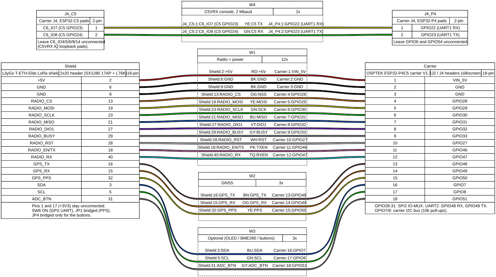

# FPVBox wiring

Hardware:
- OSPTEK ESP32-P4C5 module on the OSPTEK "ESP32P4模组基础底板" V1.3 carrier ([schematic](https://github.com/osptek/esp32-p4c5-module-dev-board/tree/main/docs)).
- LilyGo T-ETH-Elite LoRa shield with the "17AP" SX1280 + PA module and the Quectel L76K GNSS ([schematic](https://github.com/Xinyuan-LilyGO/LilyGO-T-ETH-Series/blob/master/schematic/T-ETH-ELite-LoRa-Shield.pdf)).

Sources for the facts below:
- [osptek/esp32-p4c5-core-board](https://github.com/osptek/esp32-p4c5-core-board): `images/c5-p4-connection.png` and `pages/pin-definition_EN.md`.
- [osptek/esp32-p4c5-module-dev-board](https://github.com/osptek/esp32-p4c5-module-dev-board): carrier schematic V1.3.

The diagram is generated with [WireViz](https://github.com/wireviz/WireViz) from [wiring/fpvbox.yml](wiring/fpvbox.yml): `wireviz -f sp docs/wiring/fpvbox.yml`. The carrier's pin numbers in the diagram only order the rows; the silkscreen GPIO names are what count.

## 1. ESP32-C5 ↔ ESP32-P4 inside the module (no wiring)

| ESP32-C5 | ESP32-P4 | OSPTEK use (esp-hosted) | FPVBox use |
|---|---|---|---|
| GPIO9 | GPIO18 | SDIO CLK | video bus clock, 40 MHz |
| GPIO8 | GPIO14 | SDIO D0 | video bit 0 |
| GPIO7 | GPIO15 | SDIO D1 | video bit 1 |
| GPIO14 (USB D+) | GPIO16 | SDIO D2 | video bit 2 |
| GPIO13 (USB D−) | GPIO17 | SDIO D3 | video bit 3 |
| GPIO10 | GPIO19 | SDIO CMD | video bit 4 |
| GPIO2 | GPIO6 | IO | video bit 5 |
| CHIP_PU | GPIO54 | C5 reset | C5 reset (P4 drives it open-drain) |

- **Video bus:** these seven lines carry C5VRX's digital composite output. Each 6-bit sample is sent twice on a 40 MHz clock.
- **No Wi-Fi/BLE for the P4:** the C5 radio is the video receiver and the SDIO link is not used.
- **P4 GPIO6 and GPIO54 also reach the carrier's J4 header.** GPIO6 additionally goes to the display connector's TP_RST.
  - Leave both header pins unconnected.
  - Leave the display connectors (J3 / J6) empty.

## 2. C5 console to the P4 (two jumper wires on J4)

The C5 UART pins go only to the carrier's CH343 switch, so the C5VRX console uses two other C5 GPIOs.

| From | To | Signal |
|---|---|---|
| J4 "C6_IO7" (= C5 GPIO23) | J4 "GPIO22" (P4) | C5VRX console TX → P4 RX, 2 Mbaud |
| J4 "GPIO23" (P4) | J4 "C6_IO8" (= C5 GPIO24) | P4 TX → C5VRX console RX |

J4 still uses the C6 names: C6_IO15/14/13/9/8/7/6/5/4 = C5 GPIO28/27/26/25/24/23/6/5/4.

**Leave unconnected:** J4 "C6_IO4", "C6_IO5", "C6_IO6", "C6_IO9", "C6_IO14" (C5 GPIO4/5/6/25/27). C5VRX loops its receiver IQ bits through these pads internally; any load degrades reception.

## 3. LoRa shield → carrier (jumper wires)

The shield's numbers are its 2×20 header (T-ETH-Elite pinout, schematic sheet 4). The carrier side uses the silkscreen GPIO names on J2/J4. All signals are 3.3 V.

| Shield pin | Net | Carrier | Notes |
|---|---|---|---|
| 2, 4 | +5V | VIN_5V (J2/J4 top rows) | The shield's RT9080 makes 3.3 V for the PA and GNSS |
| 6, 9, 14, 20, 25, 30, 34, 39 | GND | GND | Use at least two |
| 1, 17 | +3V3 | **not connected** | Two 3.3 V regulators must not run in parallel |
| 13 | RADIO_CS | GPIO28 | SPI2 IO-MUX pins: 28/29/30/31 |
| 19 | RADIO_MOSI | GPIO29 | |
| 23 | RADIO_SCLK | GPIO30 | |
| 21 | RADIO_MISO | GPIO31 | |
| 27 | RADIO_DIO1 (IRQ) | GPIO32 | |
| 29 | RADIO_BUSY | GPIO33 | |
| 28 | RADIO_RST | GPIO27 | |
| 18 | RADIO_EN/TX (PA TX enable) | GPIO46 | |
| 40 | RADIO_RX (LNA RX enable) | GPIO47 | |
| 16 | GPS_TX (L76K TXD) | GPIO48 | P4 UART2 RX |
| 15 | GPS_RX (L76K RXD) | GPIO49 | P4 UART2 TX |
| 32 | GPS_PPS | GPIO50 | Via JP1 |
| 31 | ADC_BTN | GPIO51 | Via JP4; optional, not used by the firmware yet |
| 3 | SDA | GPIO7 | Optional: carrier I2C bus (OLED 0x3C, BME280 0x77) |
| 5 | SCL | GPIO8 | Optional |

### On the shield
- **DIP switch SW6 ON.** It connects the L76K TXD/RXD to the header.
- **Bridge JP1** for PPS. Bridge JP4 only if you want the buttons.
- **The radio footprint is shared by several LilyGo modules.** Resistors R2/R3/R5 (RX/TX enable) and R7…R44 (SPI, IRQ) are marked "TBD" in the schematic.
  - With a multimeter, confirm that the 17AP module's RX pin reaches header pin 40 and its TX pin reaches header pin 18.
  - Confirm that DIO1, BUSY and the SPI pins reach header pins 27, 29 and 13/19/21/23.

### Antennas
- **Video:** 5.8 GHz antenna on the module's IPEX connector (LAN_OUT, the C5).
- **ELRS:** 2.4 GHz antenna on the shield's SX1280 IPEX.
- **GNSS:** active or passive GPS antenna on the L76K IPEX.
- **Never transmit with ELRS without its antenna.**

### PA output power
- LilyGo does not publish the 17AP's PA gain.
- The firmware assumes about +22 dB and stops at 100 mW (`CONFIG_FPV_ELRS_MAX_POWER_IDX=3`).
- Measure the output with a power meter or a calibrated SDR before raising that limit or editing `POWER_VALUES` in `p4/components/elrs_tx/port/options.cpp`.
- Respect your local limits; there is an EU LBT mode in menuconfig.

## 4. P4 pins already used by the carrier (do not reuse)

| GPIO | Carrier use |
|---|---|
| 7, 8 | I2C (10 k pull-ups), ES8311 control, camera level shifter |
| 9–13 | ES8311 I2S |
| 20 | Display backlight boost enable |
| 21 | Touch INT |
| 26 | Camera reset |
| 34–38 | Boot straps, UART0 (CH343 console) |
| 39–45 | TF card (keep it for DVR recording later) |
| 53 | Speaker amplifier enable |
| 24/25 | USB full-speed PHY (P4 USB-Serial-JTAG) |

## 5. USB and power
- **J8 ("USB", Type-C):** the FPVBox composite device. With VBUS on J8, the TS3USB221 routes the P4's high-speed PHY to J8 (otherwise to the USB-A port).
- **J7 (Type-C, CH343):** console and flashing.
  - Switch S1 selects the P4 (up) or the C5 (down).
  - Both boards' consoles are only needed for development.
